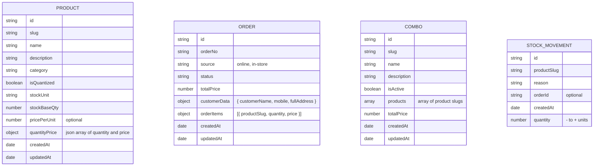

# Bensi Queen Mart — data model

## DB access rules (do not divert)

Cost model: connections are cached per warm function (connect once per cold
start). The real cost is network round-trips (~5–20ms each to Atlas). So:
one button = one composed method, never chatty N-call loops.

Three layers:

1. `packages/db` — composed methods that encode INVARIANTS, not generic CRUD.
   No `createProduct / updateProduct / deleteProduct` zoo. A method lives here
   only if it must be atomic or is needed by 2+ apps
   (e.g. `applyStockChange`, `createOrder`, shared reads like
   `getProductBySlug` / `listActiveProducts`).
2. `apps/*/api/` — endpoint = one button. Calls at most one composed
   write-method plus bulk reads, then shapes the response. App-specific flows
   live here but never reimplement stock/audit math.
3. Rules:
   - Any write touching `stockBaseQty` goes through `applyStockChange`. Hard rule.
   - Never N+1: no per-item loop of DB calls — `bulkWrite` or one transaction.
   - Fetch lists in one call and filter in memory (hundreds of products, not
     millions) instead of per-item lookups.
